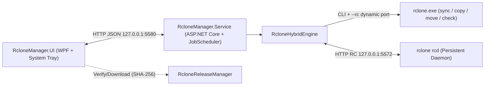

<p align="center">
  
</p>

<h1 align="center">RcloneManager</h1>

<p align="center">
  🇧🇷 <a href="README.md">Português</a> | 🇺🇸 <strong>English</strong>
</p>

Desktop GUI (**WPF**) and background Service (**ASP.NET Core + Windows Service**) built in **.NET 10** to manage [Rclone](https://rclone.org/) on Windows with a hybrid engine (**RC HTTP API + CLI**), automatic task scheduler, live transfer telemetry, filter optimizer, and automatic release-locked provisioning (**SHA-256**).

🌐 **Project Page (GitHub Pages):** [dillemon-recla.github.io/RcloneManager/?lang=en](https://dillemon-recla.github.io/RcloneManager/?lang=en)

---

## Key Features

- **Hybrid Engine (RC API + CLI)** (`RcloneHybridEngine`): evaluates each task case by case:
  - **CLI + Live RC Monitoring (`CliWithRcMonitoring`)**: runs `rclone.exe` with all native flags (`--filter-from`, `--max-size`, `--skip-links`, `--fast-list`, `--log-file`) and enables `--rc --rc-no-auth` on a dynamic port for live progress stats and bandwidth adjustment.
  - **Persistent RC Daemon (`RcDaemonApi`)**: keeps `rclone rcd` running on port `5572` for fast queries (`/config/listremotes`, `/core/version`, `/operations/about`) and direct operations without CLI-exclusive flags.
  - **Pure CLI (`PureCli`)**: automatic fallback if the RC port is unavailable.
- **Desktop GUI + Decoupled Background Service**:
  - When launching `RcloneManager.UI`, it automatically starts `RcloneManager.Service` in the background (`--background`) if it is not already running.
  - Supports minimizing to the **System Tray** (`TrayIconHelper`) or closing the window while keeping the service and scheduler active.
- **Automatic Scheduler (`JobScheduler`)**:
  - Supports `IntervalMinutes`, `DailyAtTime`, `WeeklyDays`, and `OnServiceStart`.
  - Sequential execution queue with configurable retries for transient network/DNS failures (`RetryOnFailure`, `MaxRetries`, `RetryDelayMinutes`).
- **First-Run Wizard & Streamlined Reset**:
  - On first launch (or when importing a portable config), `FirstRunWizardWindow` (`WizardOnboardingService`) guides you through: clean setup or optional `.json` import, release-locked binary verification/download, remote authentication, task review, and an **explicit background service mode selector** (*User Session without Admin*, *Native Windows Service `WinService`*, or *Manual Only*).
  - Dedicated `ResetConfigWindow` (`ConfigResetService`) to reset settings, clear logs/runtime, and optionally erase `rclone.conf` (with `.bak` backup), automatically discarding and regenerating the disposable local key.
- **Visual Remotes Manager (`rclone.conf`) with 3 Auth Modes**:
  - Direct bridge to Rclone's **71+ storage providers** (`/config/providers` and `/config/dump`), masking secrets, testing connections (`rclone lsd` + `/operations/about`), and offering an optional `rclone config` terminal.
  - Explicit authentication choice: **Via Browser Link (OAuth)** (with custom Google Drive `client_id` guidance), **Via Manual Token JSON** (with JSON validation and `rclone authorize` shortcut), or **Via Key / Credentials** (S3, SFTP, passwords, or `service_account_file` file picker).
- **Transparent Disposable-Key Protection & Portable Export**:
  - Silently manages a disposable **AES-256** key in **Windows Credential Manager** (`IMasterKeyStore` / `AesGcmDataProtector`) to protect sensitive local settings at rest (`AES-256-GCM`, `enc:v1:...`), rotating it atomically when completing the Wizard or resetting.
  - Exporting (`PortableConfigService`) creates a portable bundle **without credentials, tokens, or keys** — containing only sanitized tasks and a blueprint of the used services for guided re-authentication by the Wizard on another machine.
- **Auto-Download & Release Lock (`RcloneReleaseManager`)**:
  - If `rclone.exe` is missing or does not match the pinned version (default `v1.76.0`), the UI downloads the official `.zip` (`downloads.rclone.org` with GitHub Releases fallback), validates **SHA-256**, extracts it, and verifies `rclone.exe version`.
- **Background Auto-Update via GitHub Releases (`AppAutoUpdater`)**:
  - Automatically checks GitHub Releases, downloads the portable `.zip` package silently in the background with **SHA-256** verification, and applies the update on close or reopen while preserving all local settings and logs.
- **Filter Optimizer, 30-Day Excluded Grace & Instant Purge (`FilterFileHelper` + `ExcludedRetentionManager`)**:
  - Detects mixing `--exclude-from` with `+ ` rules (`--filter-from`), invalid inline syntax (`- * [-- max-size ...]`), root hidden folders (`- .*/**`), and *first-match-wins* ordering bugs, sanitizing automatically at runtime and offering permanent cleanup with `.bak` backup.
  - Cloud files later added to exclusion rules automatically enter a **30-day grace period** (tracked locally with zero cloud moves/copies) before deletion, paired with a **🗑 Purge Now** button for immediate cleanup.
- **Classic Menu Bar & About Window**:
  - **File** and **Help** menus (`Ctrl+N` / `Ctrl+S` shortcuts, export/import, diagnostics, and **About** window with component versions and MIT license).
- **Zero external NuGet dependencies**: built strictly with native **.NET 10** SDK frameworks (`net10.0` / `net10.0-windows`).

---

## Architecture



---

## Repository Structure

```text
RcloneManager.sln
├── Iniciar-RcloneManager.bat               # Quick launcher (builds Release if needed and opens UI)
├── LICENSE                                 # MIT License
├── assets/blender/                         # Blender 3D project (.blend) & Python render/icon scripts
├── docs/                                   # Technical documentation, GitHub Pages & icons (docs/assets/)
└── src/
    ├── RcloneManager.Core/                 # Models, Hybrid Engine, Scheduler, AES-256 Vault, Filters & Release Manager
    ├── RcloneManager.Service/              # Background Service, HTTP API (:5580) & Windows Service dispatcher
    └── RcloneManager.UI/                   # WPF Desktop GUI (Dark UI), First-Run Wizard, Remotes, About & System Tray
```

---

## Prerequisites & Quick Start

### Prerequisites
- **Windows 10 / 11** (`x64`, `arm64`, or `x86`)
- **.NET 10 SDK** (to build) or **.NET 10 Desktop + ASP.NET Core Runtime** (to run compiled binaries)

### Build & Run

```powershell
git clone https://github.com/Dillemon-Recla/RcloneManager.git
cd RcloneManager

# Build the entire solution in Release mode
dotnet build RcloneManager.sln -c Release
```

Then run **[Iniciar-RcloneManager.bat](Iniciar-RcloneManager.bat)** (or launch `src\RcloneManager.UI\bin\Release\net10.0-windows\RcloneManager.UI.exe` directly):

1. On first run, the **First-Run Wizard** lets you start fresh or import a portable `.json` config, verifies/downloads the pinned `rclone.exe` (`v1.76.0`, SHA-256), walks you through authenticating remotes (OAuth Link, Token JSON, or Key/Credentials), and lets you review your jobs while managing local encryption transparently in the background.
2. The UI automatically launches `RcloneManager.Service` in the background on `127.0.0.1:5580` and keeps the scheduler running even when minimized or closed.

---

## Technical Documentation (`docs/en/`)

- [Architecture and Hybrid Engine (RC + CLI)](docs/en/architecture-and-hybrid-engine.md)
- [Local HTTP API and Service Modes](docs/en/local-service-api.md)
- [Security, Remotes (3 Modes), Wizard, and Portable Export](docs/en/security-remotes-and-wizard.md)
- [Automatic Provisioning and Release Lock](docs/en/provisioning-and-release-lock.md)
- [Filter Rules and Optimizer](docs/en/filters-and-optimizer.md)
- [30-Day Excluded Grace Period, Instant Purge & Drive Tuning](docs/en/excluded-retention-and-drive-tuning.md)
- [Operations, Windows Service, and Troubleshooting](docs/en/operations-and-windows-service.md)

---

## Contributing

Contributions are welcome! Feel free to open **Issues** (bug reports, feature suggestions, or questions) or submit **Pull Requests** targeting `dev` / `main`.

---

## Support the Project

If **RcloneManager** helps streamline your backups and cloud sync workflow, consider supporting its ongoing development:

- **GitHub Sponsors (International / Devs):** [github.com/sponsors/Dillemon-Recla](https://github.com/sponsors/Dillemon-Recla)
- **Ko-fi (One-off / International):** [ko-fi.com/dillemonrecla](https://ko-fi.com/dillemonrecla)
- **Pix (Brazil — Random Key):** `95b9aa86-3c99-421d-9c86-6a47a3b09d7b`

<p>
  
</p>

---

## Credits to Rclone Creators

**RcloneManager** is an independent desktop interface and service wrapper built on top of **[Rclone](https://rclone.org/)**, originally created by **[Nick Craig-Wood](https://github.com/ncw)** and maintained by the **[rclone/rclone](https://github.com/rclone/rclone)** open-source community under the MIT License. You can also [support the Rclone project directly](https://rclone.org/donate/).

---

## Code Signing Policy

Free code signing provided by [SignPath.io](https://signpath.io/), certificate by [SignPath Foundation](https://signpath.org/).

- **Committers, Reviewers, and Approvers:** [@Dillemon-Recla](https://github.com/Dillemon-Recla) (project author and maintainer; all official releases are built exclusively on GitHub-hosted runners from reviewed repository commits).

---

## Privacy Policy

This program will not transfer any information to other networked systems unless specifically requested by the user or the person installing or operating it.

**RcloneManager** collects zero telemetry, analytics, or personal data. Network connections are strictly limited to:
- **GitHub Releases & Official Rclone Downloads (`github.com`, `api.github.com`, `downloads.rclone.org`):** used solely to verify and download pinned `rclone.exe` releases and optional background application updates (which can be disabled in settings).
- **User-Configured Storage Remotes:** accessed exclusively through the official `rclone.exe` binary according to the accounts and schedules explicitly configured by the user.

---

## License

Distributed under the **MIT** License. See [LICENSE](LICENSE) for more details.
