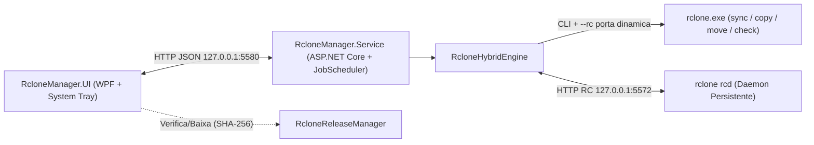

# RcloneManager

Interface Desktop (**WPF**) e Serviço em segundo plano (**ASP.NET Core + Windows Service**) em **.NET 10** para controlar o [Rclone](https://rclone.org/) no Windows com motor híbrido (**API HTTP RC + CLI**), agendador automático de tarefas, telemetria de transferências ao vivo, otimizador de filtros e provisionamento automático com trava de release (**SHA-256**).

---

## Principais Recursos

- **Motor Híbrido (RC API + CLI)** (`RcloneHybridEngine`): avalia cada tarefa caso a caso:
  - **CLI + Monitoramento RC ao vivo (`CliWithRcMonitoring`)**: executa `rclone.exe` com todas as flags nativas (`--filter-from`, `--max-size`, `--skip-links`, `--fast-list`, `--log-file`) e ativa `--rc --rc-no-auth` em porta dinâmica para ler progresso e ajustar banda ao vivo.
  - **Daemon RC persistente (`RcDaemonApi`)**: mantém `rclone rcd` na porta `5572` para consultas rápidas (`/config/listremotes`, `/core/version`, `/operations/about`) e operações diretas sem flags exclusivas de CLI.
  - **CLI puro (`PureCli`)**: fallback automático caso a porta RC não esteja disponível.
- **Interface Desktop + Serviço Desacoplado**:
  - Ao abrir a UI (`RcloneManager.UI`), ela sobe automaticamente o `RcloneManager.Service` em segundo plano (`--background`) caso ainda não esteja rodando.
  - Suporta minimizar para a **Bandeja do Sistema** (`TrayIconHelper`) ou fechar a interface mantendo o serviço e o agendador ativos.
- **Agendador Automático (`JobScheduler`)**:
  - Modos `IntervalMinutes`, `DailyAtTime`, `WeeklyDays` e `OnServiceStart`.
  - Fila sequencial com retentativas configuráveis em caso de falhas transitórias de rede/DNS (`RetryOnFailure`, `MaxRetries`, `RetryDelayMinutes`).
- **Auto-Download e Trava de Release (`RcloneReleaseManager`)**:
  - Se `rclone.exe` não existir ou divergir da versão travada (padrão `v1.76.0`), a UI baixa o `.zip` oficial (`downloads.rclone.org` com fallback para GitHub Releases), valida o hash **SHA-256**, extrai e confirma a versão executando `rclone.exe version`.
- **Analisador e Otimizador de Filtros (`FilterFileHelper`)**:
  - Detecta mistura de `--exclude-from` com regras `+ ` (`--filter-from`), sintaxe inline inválida (`- * [-- max-size ...]`) e problemas de precedência (*first-match-wins*), sanitizando automaticamente em tempo de execução e oferecendo correção definitiva com backup `.bak`.
- **Zero dependências NuGet externas**: construído apenas com os frameworks nativos do SDK **.NET 10** (`net10.0` / `net10.0-windows`).

---

## Arquitetura



---

## Estrutura do Repositório

```text
RcloneManager.sln
├── Iniciar-RcloneManager.bat               # Lançador rápido (compila em Release se necessário e abre a UI)
├── LICENSE                                 # Licença MIT
├── docs/                                   # Documentação técnica detalhada
└── src/
    ├── RcloneManager.Core/                 # Modelos, Motor Híbrido, Agendador, Filtros e Release Manager
    ├── RcloneManager.Service/              # Serviço em 2º plano, API HTTP (:5580) e dispatcher Windows Service
    └── RcloneManager.UI/                   # Interface WPF (Dark UI), diálogo de setup e System Tray
```

---

## Pré-requisitos e Início Rápido

### Pré-requisitos
- **Windows 10 / 11** (`x64`, `arm64` ou `x86`)
- **.NET 10 SDK** (para compilar) ou **.NET 10 Desktop + ASP.NET Core Runtime** (para executar os binários compilados)
- Um remote configurado no Rclone (ex.: via `rclone config` em `%AppData%\rclone\rclone.conf`)

### Compilar e Executar

```powershell
git clone https://github.com/Dillemon-Recla/RcloneManager.git
cd RcloneManager

# Compilar toda a solução em modo Release
dotnet build RcloneManager.sln -c Release
```

Em seguida, execute **[Iniciar-RcloneManager.bat](Iniciar-RcloneManager.bat)** (ou abra diretamente `src\RcloneManager.UI\bin\Release\net10.0-windows\RcloneManager.UI.exe`):

1. Na primeira abertura, se `rclone.exe` não estiver presente (ou estiver em versão diferente da release travada `v1.76.0`), a janela `RcloneSetupWindow` fará o download oficial com verificação **SHA-256** automaticamente.
2. A UI iniciará o `RcloneManager.Service` em segundo plano na porta `127.0.0.1:5580` e criará o arquivo local `rclone_manager_config.json`.

---

## Documentação Técnica (`docs/`)

- [Arquitetura e Motor Híbrido (RC + CLI)](docs/arquitetura-e-motor-hibrido.md)
- [API HTTP Local e Modos do Serviço](docs/api-local-servico.md)
- [Provisionamento Automático e Trava de Release](docs/provisionamento-e-trava-release.md)
- [Regras de Filtro e Otimizador](docs/filtros-e-otimizador.md)
- [Operação, Serviço Windows e Solução de Problemas](docs/operacao-e-servico-windows.md)

---

## Licença

Distribuído sob a licença **MIT**. Consulte [LICENSE](LICENSE) para mais detalhes.
